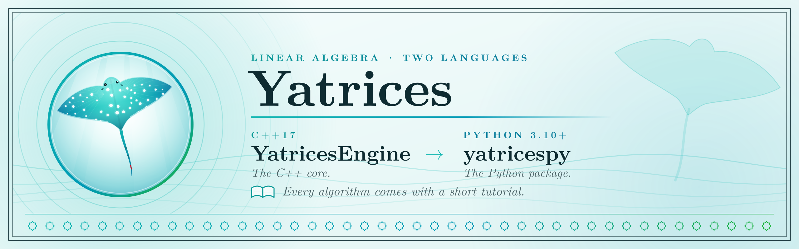
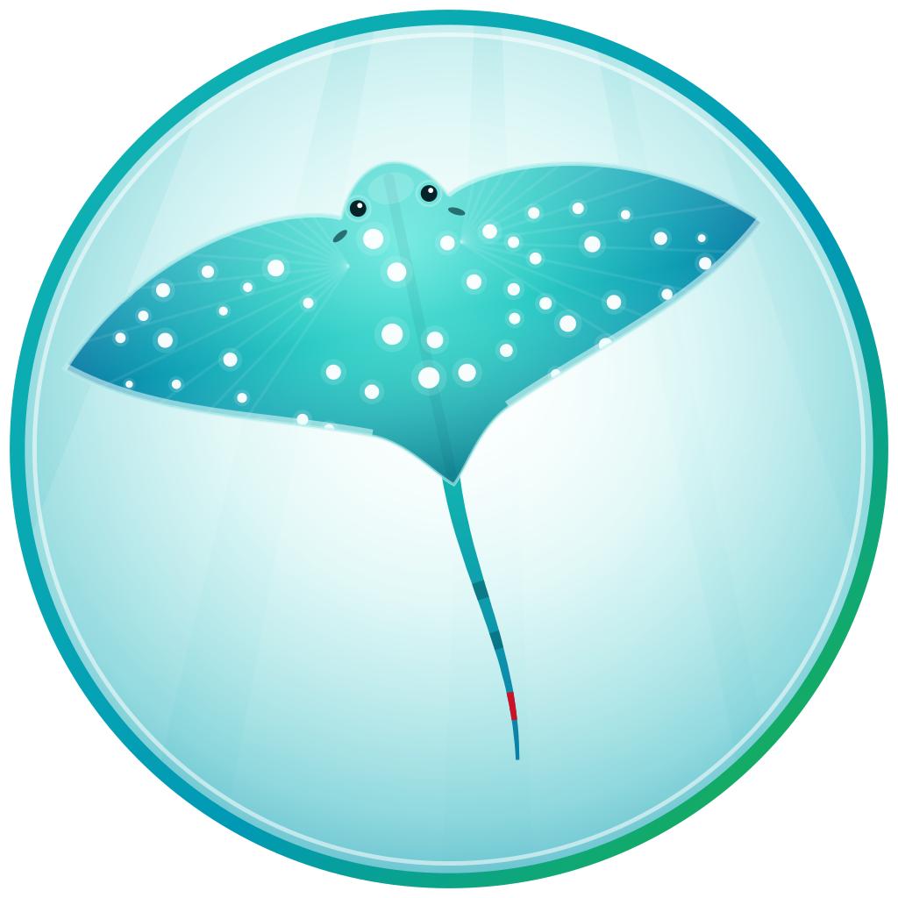
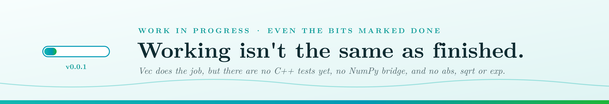
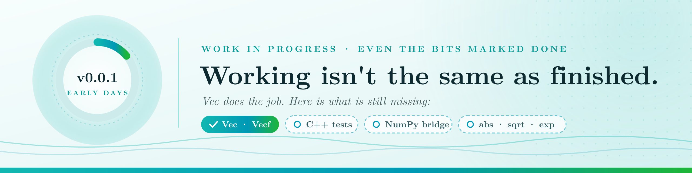
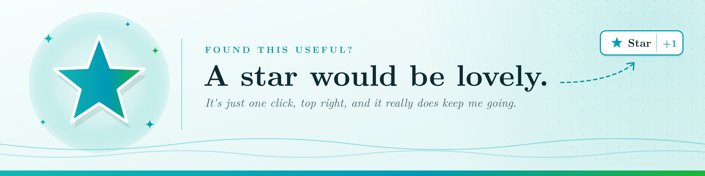

<p align="center">
  
</p>

<p align="center">
  
  
  
  
</p>

# Yatrices

Yatrices is a small linear algebra library. The heavy lifting happens in a C++ core called **YatricesEngine**, and **yatricespy** lets you use it from Python. Think of it as a homemade little cousin of `numpy.linalg`.

The name is just **Ya**ssine + ma**trices**. Nothing cleverer than that, I'm afraid.

## Why I'm doing this

For months I called `np.linalg.solve`, got my answer and moved on, without the faintest idea how it got there. That started to bother me. I'd like to work in machine learning one day, and ML is linear algebra almost wherever you look, so I decided to build it myself: in C++ first, then made usable from Python.

So it's a learning project above all. I'd much rather understand a hundred lines properly than copy a thousand.



**About the logo:** it's a spotted eagle ray. Rays glide along with hardly any effort, and that's how I'd like the library to feel. Operations should chain together naturally (`x + y + z`), and nothing should be heavier than it needs to be: a `Vec` is 16 bytes plus its data, with nothing hidden.

## Getting started

You'll need CMake 3.20 or later, a C++17 compiler and, for the Python side, Python 3.10 or later.

**Python** (pip compiles the engine for you, so a C++ compiler must be on your PATH; on Windows, MSYS2's g++ works):

```bash
python -m pip install ".[test]"
```

```python
import yatricespy as yt

x = yt.Vec([1, 2, 3])
y = yt.Vec([4, 5, 6])
print(x + y)           # [5, 7, 9]
print(x @ y)           # 32.0
print(yt.cross(x, y))  # [-3, 6, -3]
```

**C++:**

```bash
cmake -S . -B build
cmake --build build
./build/cpp/examples/example_vector_ops
```

Each side has its own guide with the full list of what's available: [Python](python/README.md) and [C++](cpp/README.md). If you want to run or write tests, have a look at [TESTING.md](TESTING.md).

## Where things stand

<p align="center"></p>

<!-- COMPARE: v2 below, delete whichever loses -->
<p align="center"></p>

The vector type is done, in both languages: `Vec` (double) and `Vecf` (float), with arithmetic, `dot`, `cross`, norms, sums and means, `angle`, `project`, `allclose`, and error messages that actually tell you what went wrong. But even the "finished" bits have plenty left to do:

- the C++ side has no automated tests yet (`cpp/tests/test_main.cpp` is empty)
- you can't convert to or from NumPy arrays without going through a list
- there's no element-wise `abs`, `sqrt`, `exp` or division
- there's no `==`, `argmin`, `argmax`, slicing or views
- `Matrix` doesn't exist yet

There are no tutorials yet either. The plan is a short one for every algorithm, explaining what it does and why it works, and they'll go in [`docs/`](docs/) later on.

What's coming next is listed in [ROADMAP.md](ROADMAP.md), and everything that has changed is in [CHANGELOG.md](CHANGELOG.md).

## How it's organised

```
cpp/      YatricesEngine, the C++ core (knows nothing about Python)
python/   yatricespy, the Python package
docs/     one tutorial per concept (none written yet)
after/    stubs for everything planned after 0.0.1
assets/   logo and banners
```

## Fancy helping?

You're very welcome, whatever your level. If you're learning this stuff too, even better.

- **Spotted a bug, or something unclear?** Open an issue. "I didn't follow this bit of the README" counts as a perfectly good issue.
- **Got an idea?** Open an issue first and we can talk it through.
- **Sending code?** Please stick to C++17, follow `.clang-format`, and check anything numerical against NumPy.

One small thing: since I'm using this project to learn, I might occasionally ask to write a feature myself, even if you've already solved it. Please don't take it personally. Reviews and "have you thought about…?" comments are always appreciated.

<p align="center"></p>

<!-- COMPARE: v2 below, delete whichever loses -->
<p align="center"></p>

## Licence

Yatrices is released under the MIT licence. See [LICENSE](LICENSE).

---

<p align="center">Made in Casablanca, with patience, a good few late evenings and far too many <code>static_assert</code>s. 🌊</p>
